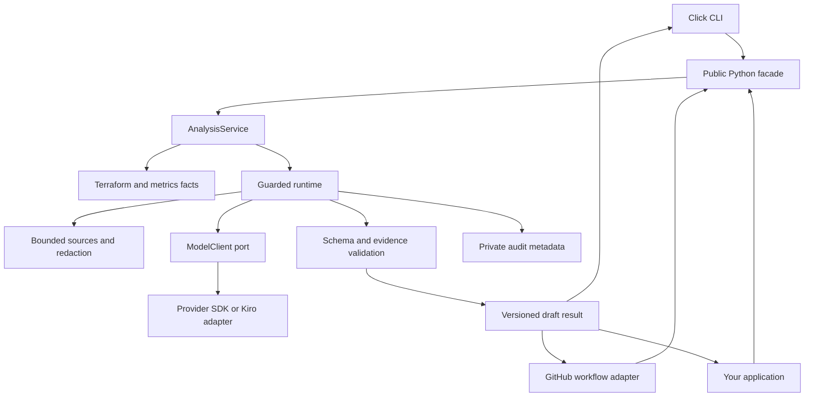

# Architecture and integration contract

RADEA separates domain checks, analysis orchestration and external adapters. It uses
small functions for deterministic rules and a service where lifecycle coordination is
needed. There is no plugin loader, global service registry or hidden automatic routing.



## Responsibility map

| Module | Responsibility | Does not own |
| --- | --- | --- |
| `radea.api` | Stable facade and explicit dependency injection | Rendering or provider-specific behavior |
| `core.models` | Frozen AnalysisRequest and ModelClient Protocol | Network or file operations |
| `core.service` | Prepare facts and coordinate one analysis use case | stdout, Click or GitHub |
| `core.runtime` | Enforce redaction, audit and result validation | Applying infrastructure changes |
| `core.prompts` | Versioned task specifications | Authorization decisions |
| `core.sources` | Bounded source collection, citations, omission metadata | Interpreting incident causes |
| `core.contracts` | Validate output shape and evidence membership | Verifying causal truth |
| `core.results` | Consistent draft/error envelope | User interface |
| `core.llm` | Explicit provider strategy and SDK/process boundary | Trusting response content |
| `iac_review.plan/policy` | Parse plan facts and apply deterministic rules | Letting models grant exceptions |
| `incident_triage.metrics` | Compare explicitly supplied numbers | Fetching or inventing historical data |
| `core.rendering` | Present result as literal text or JSON | Analysis orchestration |
| `integrations.github` | Bounded GitHub API collection and draft-comment flow | Checking out/executing PR code |
| `notify.comment` | Validate and publish a draft to an explicit target | Granting review approval or merging |

The patterns are **Facade**, **Application Service**, **Ports and Adapters**,
provider **Strategy**, and immutable request objects. They are used to isolate actual
change boundaries, not to add inheritance hierarchies. A new adapter calls the facade;
it does not duplicate sanitization, policy or evidence checks.

## Minimal Python integration

```python
from radea.api import AnalysisRequest, analyze

result = analyze(AnalysisRequest(command="debug", paths=("ci.log",)))
if "error" in result:
    raise RuntimeError(result["error"])

assert result["draft"] is True
assert result["verified"] is False
# Render/store the draft in your application's review surface.
```

`analyze()` returns data and never prints. The default model and audit configuration
come from environment variables. File/network/audit side effects remain explicit in
the service contract; a successful return does not mean a diagnosis is verified.

For reuse with explicit configuration:

```python
from radea.api import AnalysisRequest, AnalysisService, Config

service = AnalysisService(Config(model="ollama/llama3.2", audit_dir="./.radea"))
result = service.analyze(
    AnalysisRequest(command="iac-review", plan_file="plan.json", dry_run=True)
)
```

Configuration is copied per request. `local=True` on one request does not mutate the
caller's Config or affect the next request. Credentials are excluded from Config repr.
Invalid request construction raises ValueError; runtime failures return an error result.

A host may inject a callable implementing ModelClient for an approved transport or
an offline test. It receives `system`, `user`, `cfg` keyword arguments and returns a
JSON dict. This **does not bypass** schema/evidence validation. Provenance identifies
injected transport so mocked results are not confused with SDK inference. A custom
callable must honor the selected provider and the host's credentials/egress policy.

## CLI and CI contracts

- `debug`, `iac-review`, `triage`: 0 on a validated draft or dry run, 1 on failure.
- `policy-check`: 0 allow, 2 deny, 1 invalid input/configuration; no model call.
- `post-comment`: only accepts schema-versioned, evidence-validated drafts.
- Existing JSON task fields remain top-level; metadata adds schema_version, command,
  draft, verified, evidence_verified, provenance, sources, evidence and warnings.
- Credentials are configured outside AnalysisRequest. Neither prompts nor raw responses
  are included in metadata-only audit records.

Add regression cases at the public API boundary, deterministic-rule boundary, or real
SDK/process boundary being changed. Avoid tests that only repeat a mocked implementation.
See `tests/test_api.py`, `tests/test_guardrails.py` and `tests/test_integrations.py`.
