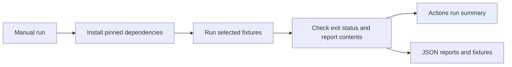
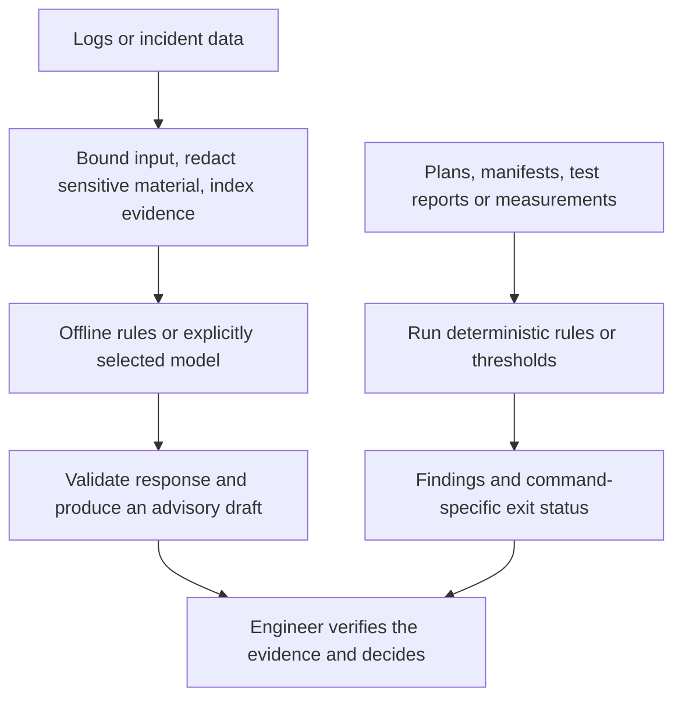
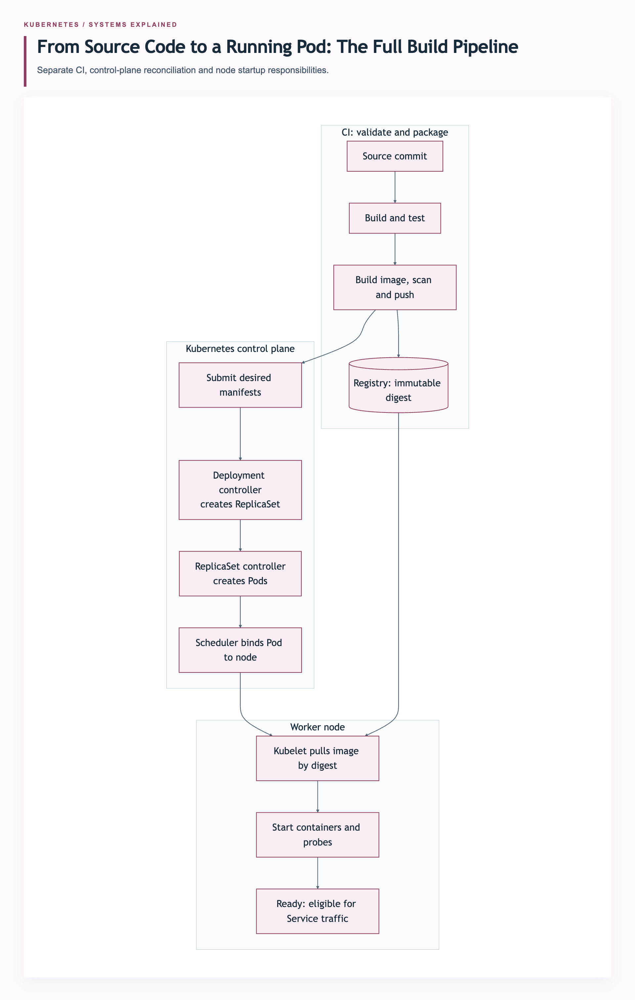
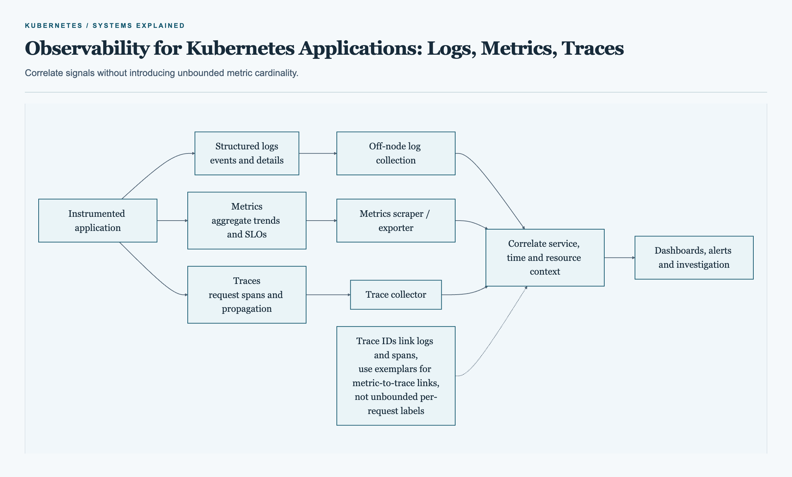

# RADEA hands-on guide

RADEA turns build logs, Terraform plans, manifests, test reports and telemetry
into evidence-linked drafts or deterministic checks. Start with a failing build,
see a policy reject an unsafe change, then follow an incident through to a
human decision. The demo uses synthetic repository fixtures and the offline
engine.

## Run the demo

On GitHub, open **Actions → RADEA Demo → Run workflow** and choose **full**.
The full run checks 26 scenarios. Use a focused track to follow one part of
the delivery lifecycle. After the run, open its summary and download the
`radea-demo-full` artifact, or the artifact named for your chosen track.
The workflow must be available on the repository's default branch to be
started manually. [Workflow source](../.github/workflows/demo.yml) ·
[GitHub manual workflow runs](https://docs.github.com/en/actions/how-tos/manage-workflow-runs/manually-run-a-workflow)

Run the same scenarios locally from a checkout with Python 3.10 or newer.

```sh
python -m venv .venv
.venv/bin/python -m pip install .
.venv/bin/python tools/run_demo.py --track full --output-dir demo-output
```

Use a new or empty output directory for each run. Installation can download
dependencies. The scenario runner forces the offline engine and uses local
files with synthetic data. The GitHub workflow uploads selected reports and
fixtures and uses read-only repository permissions.



| File | How to use it |
| --- | --- |
| `SUMMARY.md` | See each expected and actual exit code and its verification result. |
| `reports/*.json` | Inspect evidence, findings, decisions, provenance and thresholds. |
| `inputs/` | Reuse generated fixtures. Other inputs come from the repository's `examples/` directory. |
| `commands.txt` | See the CLI arguments used by the runner. Substitute local paths when replaying an artifact from another machine. |

The job passes only when each selected scenario has the expected exit code and
report contents. For example, Terraform policy denial and canary rollback both
return `2` in the fixtures. A canary hold returns `3`. Each is a successful
demonstration of the expected behavior.

## How RADEA works



Read `draft: true` as advisory output. An `evidence_verified` value of `true`
means the evidence references passed validation. The `verified` flag does
not become true because a hypothesis cites a valid line. Policy gates use
defined rules regardless of model output. Commands for applying changes or
posting comments have separate inputs and permission requirements.
[Architecture](architecture.md) · [Threat model](threat-model.md)

## Follow a delivery run

### Investigate a failed build

Select **debug**. Open `01-build-draft.json` and find the classification
`dependency_drift`. Follow the cited evidence to the input log and review
the proposed verification step. Compare it with `02-ci-log-signals.json`,
which counts signal categories, and `03-ci-graph.json`, which shows the local
pipeline's jobs and dependencies.

```sh
export RADEA_MODEL=offline
.venv/bin/radea debug --log examples/logs/failed-build.log --output json
.venv/bin/radea ci-graph examples/ci/github-good.yml
```

### Block an unsafe infrastructure change

Select **iac-review**. Compare the advisory draft in
`04-terraform-draft.json` with the deterministic decision in
`05-terraform-deny.json`. The sample plan contains a database deletion.
The gate exits `2` and records the destructive action. The safe plan passes
and the comparison reports no differences for two identical plans.

```sh
.venv/bin/radea iac-review --plan examples/evaluation/delete-plan.json --output json
.venv/bin/radea policy-check --plan examples/evaluation/delete-plan.json
```

The policy report includes these fields for the rejected fixture.

```json
{
  "decision": "deny",
  "reason": "Destructive actions require explicit approval",
  "destructive_actions": [
    {"resource": "aws_db_instance.production", "action": "destroy", "origin": "terraform_plan"}
  ]
}
```

### Review a release before deployment

Select **delivery** and compare the failing Kubernetes, Dockerfile, CI, Terraform,
test-quality and shadow-CI reports with the passing Kubernetes report.
Rule findings identify the affected location and the proposed fix.
The canary cases use fixed measurements so you can inspect why one decision is
`promote`, one is `hold` and one is `rollback`.

| Canary fixture | What changes | Decision |
| --- | --- | --- |
| Healthy | Five successful requests with p95 of 42 ms | Promote |
| Small sample | One request with a five-request minimum | Hold |
| Unhealthy | Five failed requests | Rollback |

The decisions are reports. For a cluster walkthrough, the source-to-Pod lab
generates a service, tests it, builds the image and verifies HTTP in Minikube.
The illustration shows the broader lifecycle, including the registry stage.



### Correlate an incident and hand off the decision

Select **triage** and open `08-incident-draft.json` for log patterns and
baseline deltas. `09-metric-anomaly.json` checks an elevated latency reading.
In `24-telemetry-correlation.json`, a single trace ID ties together a span,
an error log and a metric exemplar. The synthetic handoff in
`23-incident-handoff.json` references the exact draft by SHA-256 and leaves
the cause unknown.



### Connect platform decisions to measurable outcomes

Select **platform**. The fixtures flag a contract version mismatch and a
dependency registry change, evaluate a feature flag, allocate billed cost and
report time saved on a matched pilot case. The six minutes saved are fixture
data. For an adoption decision, supply measured time for execution, review
and rework, and include rejected results and critical misses.
[Evaluation playbook](evaluation.md)

## Explore capabilities beyond the offline run

| Goal | Entry point | Prerequisite |
| --- | --- | --- |
| Start a service with CI and a catalog owner | `service-scaffold --owner`, then `tools/k8s_lab.sh --source-to-pod` | Approved Python base image and Minikube for the lab |
| Check Helm changes across environments | `helm-review`, `helm-matrix` and `helm-kustomize-diff` | Local Helm charts, values and the appropriate render tools |
| Reconcile an application or test rollback | `tools/k8s_lab.sh --gitops` or `--gateway` | Minikube and the lab's documented tools |
| Run temporary PR environments and HTTP checks | `tools/k8s_lab.sh --preview` | Minikube, or a supplied cluster context and trusted image |
| Test policy, operator reconciliation and capture | `tools/k8s_lab.sh --admission`, `--operator` and `--telemetry` | A disposable Minikube cluster |
| Connect to real pipeline failures | Trusted GitHub triage and Terraform adapter templates | Reviewed action permissions and repository settings |
| Run a live provider check | `radea doctor` and `radea smoke --live` | An explicitly configured and authenticated provider |

See [deterministic commands and lab setup](static-review.md),
[GitHub integration](ci-integration.md) and [acceptance evidence](acceptance.md)
for prerequisites, permissions and result boundaries.
